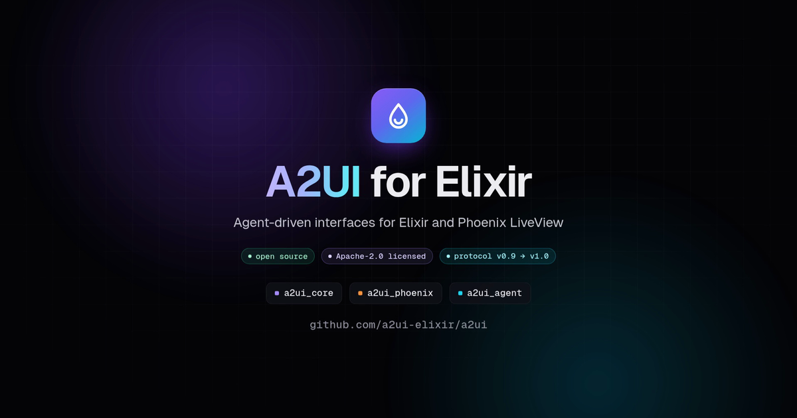

# A2UI for Elixir

[](https://a2ui-elixir.github.io/a2ui/)

[](https://github.com/a2ui-elixir/a2ui/actions/workflows/ci.yml)
[](https://hex.pm/packages/a2ui_core)
[](https://hex.pm/packages/a2ui_phoenix)
[](https://hex.pm/packages/a2ui_agent)
[](LICENSE)

An Elixir implementation of [A2UI](https://a2ui.org), the open protocol for
agent-driven interfaces. An agent sends an interface as data; your Phoenix
app renders it with components it trusts, and sends the user's actions back.
Protocol versions v0.9, v0.9.1 and v1.0, checked against the upstream
conformance suites.

**Website: [a2ui-elixir.github.io/a2ui](https://a2ui-elixir.github.io/a2ui/)**,
with recorded runs of the examples.
**Video: [A2UI for Elixir in a minute](https://www.youtube.com/watch?v=16X-sRsGlcs)**
(1:03, on YouTube).

## Packages

| Package | What it is | Docs |
|---|---|---|
| [`a2ui_core`](https://hex.pm/packages/a2ui_core) | The protocol engine: messages, catalogs, surface state, node resolution, function calls. Pure Elixir; Jason is its only dependency. | [HexDocs](https://hexdocs.pm/a2ui_core) |
| [`a2ui_phoenix`](https://hex.pm/packages/a2ui_phoenix) | A Phoenix LiveView renderer: the basic catalog as function components, two-way bindings, actions, and A2UI messages over server-sent events. | [HexDocs](https://hexdocs.pm/a2ui_phoenix) |
| [`a2ui_agent`](https://hex.pm/packages/a2ui_agent) | The agent SDK: catalog negotiation, prompts in the direct JSON and Express formats, validated parsing of streamed model output, skills, and serving over A2A, MCP and AG-UI. | [HexDocs](https://hexdocs.pm/a2ui_agent) |

## Installation

Add the packages you need to `mix.exs`. Both `a2ui_phoenix` and `a2ui_agent`
bring `a2ui_core` with them.

```elixir
def deps do
  [
    # Render agent interfaces in a Phoenix LiveView app
    {:a2ui_phoenix, "~> 0.1.0"},
    # Write the agent that sends them
    {:a2ui_agent, "~> 0.1.0"}
  ]
end
```

## Quick start

### Render surfaces in LiveView

```elixir
defmodule MyAppWeb.AgentLive do
  use MyAppWeb, :live_view

  alias A2UIPhoenix.{Live, Session}

  def mount(_params, _session, socket) do
    # Check every component against its catalog; relaxed validation still
    # accepts a surface whose components arrive over several messages.
    validation = A2UICore.Validation.Config.relaxed()
    session = Session.new([A2UICore.Catalog.Basic.catalog("v1.0")], validation: validation)
    {:ok, Live.init(socket, session, on_send: &send_to_agent/2)}
  end

  # Messages from the agent, however they arrive (SSE, A2A, a process).
  def handle_info({:agent, payload}, socket) do
    {_result, socket} = Live.handle_message(socket, payload)
    {:noreply, socket}
  end

  def render(assigns) do
    ~H"""
    <.live_component
      :for={surface <- Session.surfaces(@a2ui)}
      module={A2UIPhoenix.Surface}
      id={"surface-" <> surface.id}
      session={@a2ui}
      surface_id={surface.id}
    />
    """
  end

  # Messages for the agent: actions, errors, function calls and responses.
  defp send_to_agent(message, socket) do
    Phoenix.PubSub.broadcast(MyApp.PubSub, "a2ui:renderer", {:renderer, self(), message})
    socket
  end
end
```

Import the package's `a2ui_phoenix.js` and `a2ui_phoenix.css` into your
assets. The guide,
[Rendering surfaces](https://hexdocs.pm/a2ui_phoenix/rendering_surfaces.html),
shows how, and covers theming, agent functions, catalogs of your own and the
MCP catalog.

### Serve an agent over A2A

```elixir
defmodule MyAgent do
  @behaviour A2UIAgent.A2A.Agent

  alias A2UIAgent.A2A.Request

  # No catalog negotiated with the renderer: answer in text.
  @impl true
  def run(%Request{processor: nil, text: text}), do: {:ok, MyModel.reply(text)}

  # Put the negotiated catalogs in the model's prompt; its output, whole or
  # streamed, goes back to the renderer as validated A2UI messages.
  def run(%Request{processor: processor, text: text, events: events}) do
    {:ok, prompt} = A2UIAgent.RequestProcessor.prompt(processor)
    {:ok, MyModel.stream(prompt, text, events)}
  end

  @impl true
  def options do
    basic = A2UIAgent.CatalogConfig.new(A2UICore.Catalog.Basic.catalog("v1.0"))
    [generator: A2UIAgent.Generator.new([basic])]
  end

  @impl true
  def card do
    %{
      "name" => "My agent",
      "capabilities" => %{"extensions" => [A2UIAgent.A2A.agent_extension("1.0")]}
    }
  end
end

# In a Phoenix router or a Plug.Router:
forward "/a2a", A2UIAgent.A2A.Plug, agent: MyAgent
```

`MyModel` stands for your model client. The guide,
[Serving an agent](https://hexdocs.pm/a2ui_agent/serving_an_agent.html),
covers prompts, parsing, Express, MCP and AG-UI. To work with the protocol
directly, without a renderer or an agent, start with
[Processing messages](https://hexdocs.pm/a2ui_core/processing_messages.html).

## Examples

[`examples/`](examples/README.md) holds three applications that use the
packages together:

| Example | What it is |
|---|---|
| [`restaurant_agent`](examples/restaurant_agent/README.md) | An agent that finds restaurants and books tables, served over A2A, MCP, AG-UI, server-sent events and WebSocket. |
| [`gallery`](examples/gallery/README.md) | A Phoenix LiveView app: scenarios that cover the protocol, the upstream example surfaces, and a live chat with the restaurant agent. |
| [`terminal_client`](examples/terminal_client/README.md) | A renderer that draws surfaces in the terminal, with a client for every transport the agent serves. |

## Conformance

Of the 1144 upstream cases at the pinned commit (`SPEC_PIN`), 946 run
and all of them pass. The others are skipped, each for a stated reason:

| Suite family | Cases | Run | Skipped |
|---|---:|---:|---|
| `core` | 572 | 533 | 39 for protocol v0.8 |
| `agent` (shared suites) | 107 | 107 | none |
| `agent/direct_json` | 163 | 124 | 39 for v0.8 catalogs |
| `agent/express` | 115 | 115 | none |
| `agent/builder` | 11 | 11 | none |
| `agent/macros` | 18 | 18 | none |
| `agent/legacy` | 133 | 25 | 67 whose rules the blueprint suites replaced, 39 for protocol v0.8, 2 in the Elemental and Atom formats |
| `extensions/a2a` | 14 | 13 | 1 v0.8 payload |
| `extensions/adk` | 11 | 0 | adapters for Google's Python ADK |

Where the packages deliberately differ from the reference implementations,
[`NOTES/divergences.md`](NOTES/divergences.md) says how and why.

## Repository

| Path | What it holds |
|---|---|
| `umbrella/apps/` | The three packages, and `a2ui_conformance`, the unpublished harness that runs the upstream suites |
| `examples/` | The example applications |
| `site/` | The website, a Phoenix app exported as static files and published on GitHub Pages |
| `NOTES/` | Protocol research and the deliberate divergences from the reference |
| `PLAN.md`, `TODO.md` | The plan the packages were built from, and the log of the work |

[`CONTRIBUTING.md`](CONTRIBUTING.md) covers the development setup, the
pinned upstream checkout the test suites run against, releasing, and moving
to a newer specification. To report a security issue, see
[`SECURITY.md`](SECURITY.md).

## License

Apache-2.0 ([`LICENSE`](LICENSE)), the license of the A2UI specification and
its conformance suites too. The JSON schemas and catalogs under
`umbrella/apps/a2ui_core/priv` are copies of the specification's files, with
its license file (`priv/LICENSE-APACHE`).
